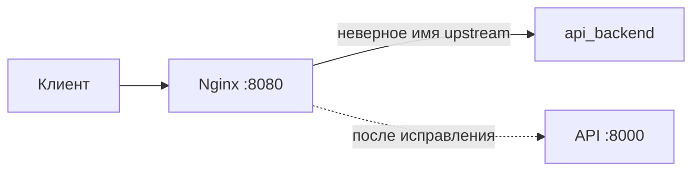

# Linux Troubleshooting Lab

Небольшая практическая лаборатория по поиску причин сбоев. В каждом сценарии есть симптомы, команды для сбора фактов, исправление и проверка результата. Сценарии запускаются локально и не меняют настройки хостовой системы.

## Сценарии

| Сценарий | Симптом | Что тренируем |
|---|---|---|
| [01 — Nginx возвращает 502](scenarios/01-nginx-502/README.md) | Прокси не может найти upstream | Логи, DNS внутри Docker-сети, конфигурация Nginx |

## Быстрый старт

Нужны Docker Engine и Docker Compose v2.

```bash
cd scenarios/01-nginx-502
docker compose up -d --build
curl -i http://localhost:8080/
```

Ожидаемый симптом — `502 Bad Gateway`. Попробуй сам найти причину по сценарию, прежде чем открывать [разбор](scenarios/01-nginx-502/SOLUTION.md).

Остановить стенд:

```bash
docker compose down
```

## Как устроен сценарий



## Формат разбора инцидента

В каждом сценарии фиксируй не только команды, но и логику: что увидел, какие версии проверил, какие данные подтвердили причину, что изменил и как проверил восстановление. Для заметок есть [шаблон отчёта](templates/incident-report.md).

## План развития

- [x] Nginx 502 из-за неверного upstream
- [ ] Сервис не стартует из-за неверного параметра systemd
- [ ] Диск заполнен логами: поиск крупных файлов и безопасная очистка
- [ ] PostgreSQL недоступен из-за неправильных реквизитов
- [ ] Регрессия в Git: поиск виновного коммита через `git bisect`

